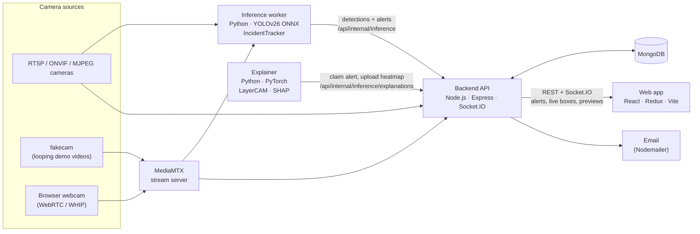

# Spatiotemporal YOLOv26 Fire & Smoke Detection with Explainable AI

**A multi-tenant, real-time fire and smoke surveillance platform for CCTV cameras.** A YOLOv26 model (ONNX, CPU-first) watches live RTSP, ONVIF and webcam streams, a spatiotemporal incident tracker confirms detections over consecutive frames, and every alert explains itself: the exact rule that fired, a LayerCAM heatmap of what the model looked at, and (once enough alerts are labelled) a SHAP-explained false-alarm likelihood.

Built with the **MERN stack** (MongoDB, Express, React, Node.js), **Socket.IO** for live alerts and previews, and **Python** services for inference and explainability. Developed as a final year project (FYP) and structured as a SaaS foundation.

**Highlights**

- Real-time fire and smoke detection on CCTV with YOLOv26 and ONNX Runtime
- Spatiotemporal confirmation (consecutive frames, cooldown, incident timeline) to cut false alarms
- Explainable AI (XAI): decision trace, LayerCAM heatmaps, SHAP false-alarm likelihood
- RTSP, HTTP MJPEG, ONVIF (with LAN discovery), looping demo videos and laptop webcams (WebRTC/WHIP)
- Multi-tenant SaaS: organizations, subscription plans, checkout and renewal, role-based access control
- Live camera grid, alert lifecycle with audit trail, email notifications and analytics reports

---

## Contents

1. [Problem and solution](#1-problem-and-solution)
2. [Architecture](#2-architecture)
3. [Features](#3-features)
4. [Technology stack](#4-technology-stack)
5. [Project structure](#5-project-structure)
6. [Getting started](#6-getting-started)
7. [Running with Docker](#7-running-with-docker)
8. [Demo cameras (no hardware)](#8-demo-cameras-no-hardware)
9. [AI model and inference](#9-ai-model-and-inference)
10. [Explainable alerts (XAI)](#10-explainable-alerts-xai)
11. [Roles and access](#11-roles-and-access)
12. [Alert workflow](#12-alert-workflow)
13. [Data model](#13-data-model)
14. [API overview](#14-api-overview)
15. [Security](#15-security)
16. [Testing](#16-testing)
17. [Deployment](#17-deployment)
18. [Roadmap](#18-roadmap)
19. [Documentation](#19-documentation)
20. [License](#20-license)

---

## 1. Problem and solution

Conventional smoke and heat detectors are slow in large or open spaces, trigger on steam, dust or cooking, and are hard to monitor across many sites. Video-based detection reacts sooner and covers wider areas, but operators only trust it if false alarms stay low and each alert can be checked quickly.

This platform addresses both:

- **Early detection:** YOLOv26 runs on live camera streams every 500 ms by default.
- **Fewer false alarms:** an alert needs several consecutive positive frames, and repeated alerts are held back by a per-camera cooldown.
- **Explained alerts:** operators see why an alert fired and where the model looked, and can record the cause of a false alarm. Those labels later train a false-alarm likelihood model.
- **Scale:** organizations are isolated from each other, cameras and operators are managed per organization, and alerts are pushed to every connected user in real time.

---

## 2. Architecture



| Component | Responsibility |
|---|---|
| **Inference worker** (`python-services/inference`) | Reads each enabled camera, runs YOLOv26 with ONNX Runtime, tracks incidents over time, and posts detections and alerts to the backend. |
| **Backend** (`backend/`) | REST API, authentication, multi-tenant access rules, alert lifecycle, notifications, camera health checks, live previews (ffmpeg) and Socket.IO broadcasting. |
| **Explainer** (`python-services/inference/app/xai`) | A separate process that claims new alerts, renders LayerCAM heatmaps from `best.pt`, and trains and serves the false-alarm likelihood model. It never delays an alert. |
| **MediaMTX + fakecam** (`infra/`) | Demo stream server: loops videos as RTSP cameras and accepts browser webcams over WebRTC. |
| **Frontend** (`frontend/`) | Role-based dashboards, live camera grid with detection overlays, alert drawer with explanations, reports and subscription portal. |

---

## 3. Features

**Detection and monitoring**
- YOLOv26 fire and smoke detection (classes `fire`, `smoke`, `other`) at 960 px input on CPU
- Spatiotemporal incident tracking: start and end times, detection frequency, spread rate
- Live camera grid with JPEG previews over Socket.IO (one shared ffmpeg per watched camera)
- Fullscreen live view with server-side detection boxes (`detection:live`)
- Camera health monitor that marks cameras online or offline from the stream itself
- Pause a camera indefinitely or for a set time; it resumes automatically

**Cameras**
- Source types: RTSP, HTTP MJPEG, ONVIF, demo video and laptop webcam
- ONVIF: LAN discovery (WS-Discovery), stream lookup from the device, encrypted stored passwords
- Soft delete with restore, permanent delete, and operator assignment per camera

**Alerts and explainability**
- Alert lifecycle: active → acknowledged → resolved or false alarm, with a full audit trail
- Severity from peak confidence: Low, Medium (40%+), High (60%+), Critical (80%+)
- "Why this alert" decision trace, per-box class scores and confirming frames
- LayerCAM heatmaps with a model-focus score per box
- False-alarm causes (sunlight reflection, artificial light, steam/fog/dust, controlled flame, screen or image, other)
- SHAP-explained false-alarm likelihood (advisory only)
- Reports → "Explainable AI": model card, false-alarm causes, per-camera rates, detection location map

**Platform**
- Email/password sign-up with email verification, Google OAuth, password reset
- Self-service checkout: a customer buys a plan and becomes the admin of a new organization
- Subscription renewal, re-subscribe and plan limits on cameras and operators
- Super admin console for organizations, users, plans, orders and global alerts
- Email notifications and in-app notifications

---

## 4. Technology stack

| Layer | Technologies |
|---|---|
| Frontend | React 18, Vite 5, Redux Toolkit, React Router, Tailwind CSS, Recharts, Socket.IO client, Lucide icons |
| Backend | Node.js 22, Express, Mongoose, Socket.IO, Passport (Google OAuth 2.0), JSON Web Tokens, Nodemailer, Helmet, express-rate-limit, Joi, ffmpeg |
| Database | MongoDB 7 |
| Inference | Python 3.10+, ONNX Runtime, OpenCV, NumPy, httpx, pydantic-settings |
| Explainability | PyTorch (CPU), Ultralytics, scikit-learn (gradient boosting), SHAP |
| Streaming | MediaMTX (RTSP, WebRTC/WHIP), ffmpeg |
| Infrastructure | Docker, Docker Compose, NGINX |

---

## 5. Project structure

```text
.
├─ backend/                    Node.js + Express API and Socket.IO server
│  ├─ config/                  Database connection and environment checks
│  ├─ controllers/             Route handlers (auth, cameras, alerts, insights, explanations, ...)
│  ├─ middleware/              Auth, validation, rate limits, inference key checks
│  ├─ models/                  Mongoose models (User, Organization, Camera, Alert, ...)
│  ├─ routes/                  Express routers, including internal service routes
│  ├─ services/                Alert creation, explanations, camera health, live previews, ONVIF, email
│  ├─ sockets/                 Socket.IO rooms and emitters
│  ├─ scripts/                 Dev helpers (free port, XAI demo seed)
│  ├─ tests/                   Node test suites
│  └─ server.js                Entry point
├─ frontend/                   React + Vite web app
│  └─ src/
│     ├─ pages/                superadmin, orgadmin, operator, customer, auth, public
│     ├─ components/           alerts, cameras, shell, ui, ...
│     ├─ hooks/                Live detection, camera previews, pause, authenticated media
│     ├─ services/             API client and socket service
│     ├─ store/                Redux Toolkit slices
│     └─ utils/                Camera playback, WHIP publisher, ...
├─ python-services/inference/  YOLOv26 inference worker and explainer
│  ├─ app/                     Worker, model, stream reader, incident tracker, xai/
│  ├─ config/classes.json      Class names and model input size
│  ├─ tests/                   Python unit tests
│  └─ weights/                 best.onnx, best.pt, risk_model.joblib (gitignored)
├─ infra/                      MediaMTX config and the fakecam image
├─ demo_videos/                Sample fire and smoke clips for demo cameras
├─ docs/                       Architecture decisions, iteration notes, plans, QA checklist
├─ docker-compose.yml          Full stack
├─ docker-compose.demo.yml     MediaMTX + fakecam only (for `npm run dev`)
├─ Dockerfile                  Backend image
├─ nginx.conf                  Reverse proxy example
└─ .env.example                All settings with comments
```

---

## 6. Getting started

### Prerequisites

- Node.js 18+ (22 recommended) and npm
- MongoDB 6+ (local or Atlas)
- Python 3.10+ for the inference worker
- ffmpeg on your `PATH` (live previews and camera health checks)
- Docker (optional, for demo cameras or the full stack)

### Setup

```bash
git clone https://github.com/mabdullahkhurshid/spatiotemporal-yolov26.git
cd spatiotemporal-yolov26

# Backend and frontend dependencies
npm run install-all

# Python inference worker
pip install -r python-services/inference/requirements.txt

# Configuration
cp .env.example .env
cp python-services/inference/.env.example python-services/inference/.env
```

Edit `.env`. At minimum set `MONGODB_URI`, `JWT_SECRET`, `JWT_REFRESH_SECRET` and `INFERENCE_SERVICE_API_KEY`, and use the same `INFERENCE_SERVICE_API_KEY` in `python-services/inference/.env`. Every setting is explained in [.env.example](.env.example).

Place the trained model at `python-services/inference/weights/best.onnx` (see [section 9](#9-ai-model-and-inference)).

### Run

```bash
npm run dev        # backend + frontend + inference worker
npm run dev:xai    # the same, plus the explainer
```

| Service | URL |
|---|---|
| Web app | http://localhost:5173 |
| API | http://localhost:5000 |
| Health check | http://localhost:5000/health |

### Useful scripts

| Script | What it does |
|---|---|
| `npm run server` / `npm run client` | Backend or frontend only |
| `npm run inference` | Inference worker only |
| `npm run explainer` | Explainer only (needs `requirements-xai.txt`) |
| `npm run demo:up` / `demo:down` / `demo:logs` | Start, stop or follow MediaMTX + fakecam in Docker |
| `npm run train:risk` | Train the false-alarm likelihood model now |
| `npm run seed:xai-demo -- --camera <id>` | Fill one camera with labelled sample alerts (refuses production; `--remove` deletes them) |
| `npm test` | Backend tests |
| `npm run test:inference` | Python tests |
| `npm run build` | Production build of the frontend |

---

## 7. Running with Docker

```bash
cp .env.example .env    # set JWT_SECRET, JWT_REFRESH_SECRET, INFERENCE_SERVICE_API_KEY, MEDIAMTX_INTERNAL_PASS
docker compose up -d --build
```

`docker-compose.yml` starts:

| Service | Purpose |
|---|---|
| `mongodb` | MongoDB 7, bound to `127.0.0.1` only |
| `backend` | API and Socket.IO on port 5000, with a health check |
| `inference` | YOLOv26 ONNX worker (reads weights read-only) |
| `explainer` | LayerCAM and false-alarm model, limited to 2 CPUs |
| `mediamtx` | RTSP (8554) and WebRTC (8889) stream server |
| `fakecam` | Loops every `demo_videos/*.mp4` as an RTSP camera |

In production the backend refuses to start with missing or placeholder secrets. Serve `frontend/dist` with NGINX using [nginx.conf](nginx.conf); it blocks `/api/internal` from the public internet. See [DEPLOYMENT.md](DEPLOYMENT.md).

---

## 8. Demo cameras (no hardware)

`docker compose up` also starts **mediamtx** (stream server) and **fakecam**. Running the app on the host with `npm run dev` instead? Run `npm run demo:up` once: it starts just those two from `docker-compose.demo.yml`, and Docker restarts them whenever it starts (`npm run demo:down` removes them). Then, in org admin → Cameras → Add camera:

- **Demo video:** pick a video from `demo_videos/`. fakecam loops every `<name>.mp4` at `rtsp://mediamtx:8554/demo/<name>` (names: letters, digits, `_`, `-`). New files appear in the dropdown and start streaming within seconds.
- **Laptop camera:** after adding, open its live view and press **Start**. The browser streams its camera over WebRTC to `webcam/<cameraId>`. The feed is live only while that view is open, and camera access needs `http://localhost` or HTTPS. To broadcast from another device, add the host's LAN IP to `webrtcAdditionalHosts` in `infra/mediamtx/mediamtx.yml`.

Settings are in `.env.example` (`DEMO_CAMERAS_ENABLED`, `MEDIAMTX_*`). Demo cameras are off by default in production.

---

## 9. AI model and inference

The model is trained **outside** this repository (Google Colab + Roboflow, YOLOv26) and exported to ONNX.

1. Put `best.onnx` in `python-services/inference/weights/` (gitignored). For the explainer, also add `best.pt` from the same training run.
2. Set the same `INFERENCE_SERVICE_API_KEY` in the root `.env` and in `python-services/inference/.env`.
3. Start the worker with `npm run dev` or `npm run inference`.

The worker polls enabled cameras, runs ONNX Runtime on the CPU, and posts to `POST /api/internal/inference/ingest`. The backend stores alerts and incidents and broadcasts `detection:live` boxes to viewers.

Main settings (`python-services/inference/.env`):

| Variable | Default | Meaning |
|---|---|---|
| `INFERENCE_CONF_THRESHOLD` | `0.35` | Minimum box confidence |
| `INFERENCE_IOU_THRESHOLD` | `0.45` | Non-maximum suppression overlap |
| `INFERENCE_FRAME_INTERVAL_MS` | `500` | Time between analysed frames per camera |
| `INFERENCE_MAX_CONCURRENT_CAMERAS` | `4` | Cameras processed in parallel |
| `INFERENCE_MIN_CONSECUTIVE` | `3` | Positive frames needed before an alert |
| `INFERENCE_INCIDENT_MIN_CONSECUTIVE` | `3` | Positive frames needed before an incident opens |

More detail: [python-services/inference/README.md](python-services/inference/README.md).

---

## 10. Explainable alerts (XAI)

Every alert answers two questions for the operator: **why did the rules fire**, and **what did the model look at**.

| Layer | Technique | What the operator sees |
|---|---|---|
| Decision trace | Exact rule trace from the incident tracker and severity bands | Thresholds, confirming frames, per-class box scores, and plain-language reasons (also in the alert email) |
| Visual explanation | LayerCAM on `best.pt` (same weights as `best.onnx`) | "Original / Model focus" toggle and a model-focus percentage per box, with a warning below 50% |
| False-alarm likelihood | Gradient boosting with SHAP (TreeExplainer) | Probability, level and the top three contributing factors. Advisory only: it never suppresses an alert or changes severity |

How it runs:

- Set `XAI_ENABLED=true` and start the explainer (`npm run explainer` or the `explainer` Docker service). Alerts with a snapshot and a fire or smoke box are queued; the heatmap arrives a few seconds later through the `alert:explained` socket event.
- The false-alarm model trains only from operator outcomes, and only once there are at least 150 labelled alerts with 30 of each class and a cross-validated ROC-AUC of at least 0.6. It retrains every `XAI_RETRAIN_HOURS` (default 24).
- Org admins see the results under Reports → "Explainable AI". Super admins see the model status on their dashboard.

Design notes and the reasons LIME was rejected: [docs/plans/2026-10-19-explainable-alerts.md](docs/plans/2026-10-19-explainable-alerts.md) and ADR-009 in [docs/ARCHITECTURE_DECISIONS.md](docs/ARCHITECTURE_DECISIONS.md).

---

## 11. Roles and access

Access rules are enforced by the backend on every request; the frontend only mirrors them.

| Role | Can |
|---|---|
| **Customer** | Sign up, manage their profile, browse plans and buy a subscription. Buying a plan creates their organization and makes them its org admin. |
| **Org admin** | Manage the organization, cameras and operators; assign cameras to operators; view live streams and all organization alerts; resolve alerts and mark false alarms; view reports and explainability insights; renew the subscription. |
| **Operator** | See only assigned cameras and their alerts; view live streams with detection overlays; acknowledge, resolve or mark alerts as false alarms. Cannot see billing, other operators or global analytics. |
| **Super admin** | Manage organizations, users, subscription plans and orders; view alerts across all organizations and platform-wide model status. |

---

## 12. Alert workflow

### Detection and confirmation

1. The worker analyses a frame from each enabled camera every 500 ms.
2. Boxes below `INFERENCE_CONF_THRESHOLD` are dropped.
3. An alert needs a `fire` or `smoke` box in `INFERENCE_MIN_CONSECUTIVE` consecutive frames (3 by default).
4. After an alert, the same camera cannot raise another for 60 seconds (cooldown).
5. An incident ends after 30 seconds without detections. Incidents record start and end, frequency and spread rate.
6. Severity comes from the peak confidence: Critical ≥ 80%, High ≥ 60%, Medium ≥ 40%, otherwise Low.

### Lifecycle

| Status | Meaning |
|---|---|
| `active` | Created by the detector |
| `acknowledged` | An operator or admin has seen it |
| `resolved` | Handled (resolution type: extinguished, evacuated, test drill, other) |
| `false_alarm` | Not a fire, with an optional cause for the false-alarm model |

Each change is recorded in the alert's `actions` history (who, when, optional note).

### Notifications

On creation the backend stores the alert, creates in-app notifications for the org admins and the operators assigned to that camera, emails the org admins, and emits `alert:new` over Socket.IO. Lifecycle changes emit update events so every dashboard refreshes immediately.

---

## 13. Data model

| Collection | Purpose |
|---|---|
| `User` | Accounts, roles (`super_admin`, `org_admin`, `operator`, `customer`), verification, Google ID |
| `Organization` | Tenant, status and plan limits |
| `SubscriptionPlan`, `Order`, `Subscription` | Plans, checkout orders and active subscriptions |
| `Camera` | Source type (`ip_rtsp`, `http_mjpeg`, `onvif`, `demo_feed`, `webcam`), stream address, status, health, soft delete |
| `OperatorCameraAssignment` | Which operator sees which camera |
| `Alert` | Confidences, severity, lifecycle, snapshot, false-alarm cause, explanation, audit trail |
| `FireIncident` | Incident timeline from the tracker |
| `Notification` | In-app notifications |
| `AuditLog` | Security-relevant actions |
| `XaiModelStatus` | Current state of the false-alarm model |
| `Contact` | Support form messages |

---

## 14. API overview

All routes are prefixed with `/api`. Internal routes are for the inference worker, explainer and MediaMTX only and are blocked by the public proxy.

| Area | Main endpoints |
|---|---|
| Auth | `POST /auth/register`, `/auth/verify-email`, `/auth/login`, `/auth/refresh`, `/auth/logout`, `/auth/forgotpassword`, `PUT /auth/resetpassword`, `GET /auth/google`, `GET /auth/me` |
| Cameras | `GET/POST /cameras`, `PUT/DELETE /cameras/:id`, `PUT /cameras/:id/pause` and `/resume`, `POST /cameras/onvif/discover` and `/onvif/probe`, `GET /cameras/demo-feeds`, `GET /cameras/:id/stream/mjpeg` |
| Alerts | `GET /alerts`, `GET /alerts/:id`, `GET /alerts/stats`, `GET /alerts/insights`, `PUT /alerts/:id/acknowledge`, `/resolve`, `/false-alarm` |
| Incidents | `GET /incidents`, `GET /incidents/:id`, `GET /incidents/stats` |
| Organizations and users | `/organizations`, `/users`, `/operator-assignments` |
| Billing | `/subscription-plans`, `POST /subscriptions/checkout`, `GET /subscriptions/me`, `/orders` |
| Notifications | `/notifications` |
| Internal | `/internal/inference/ingest`, `/internal/inference/explanations/*`, `/internal/mediamtx/*` |

---

## 15. Security

- Short-lived access tokens kept in memory, refresh token in an httpOnly `SameSite=strict` cookie, "log out everywhere"
- Production start-up refuses missing, short or placeholder secrets
- Rate limits on the API, login, email sending, contact form and ONVIF actions
- MongoDB operator injection blocked on every request
- Camera stream addresses checked against loopback, link-local and blocked hosts
- ONVIF camera passwords encrypted at rest (`CAMERA_CREDENTIALS_KEY`)
- Service keys compared in constant time; internal routes never exposed through NGINX
- Alert snapshots and heatmaps served only to users who may see that alert
- MongoDB bound to localhost in Docker; see [DEPLOYMENT.md](DEPLOYMENT.md) to enable authentication

---

## 16. Testing

```bash
npm test                 # backend: 134 tests (auth, security, cameras, streams, inference ingest, explanations, insights, ...)
npm run test:inference   # Python: 40 tests (detector, tracker, config, backend client, LayerCAM, false-alarm model)
npm run build            # frontend production build
cd frontend && npm run lint
```

Manual QA steps for each release are in [docs/REGRESSION_CHECKLIST.md](docs/REGRESSION_CHECKLIST.md).

---

## 17. Deployment

[DEPLOYMENT.md](DEPLOYMENT.md) covers a VPS (Ubuntu, PM2, NGINX), Docker Compose and MongoDB Atlas, plus the environment variable checklist, network exposure, MongoDB authentication, backups and troubleshooting.

Production checklist in short:

- Terminate HTTPS at NGINX and set `TRUST_PROXY=1` behind it
- Set `FRONTEND_URL` and `SOCKET_CORS_ORIGIN` to the deployed address
- Generate long random secrets and set `CAMERA_CREDENTIALS_KEY` before adding ONVIF cameras
- Keep MongoDB off the public network

---

## 18. Roadmap

- **Sensor fusion:** combine gas and temperature readings (Arduino, MQ-series sensors) with video confidence. The data model leaves room for this; it is not implemented yet.
- **Edge deployment:** run the inference worker on a Raspberry Pi next to the cameras.
- **Mobile app** for operator push alerts.
- **Building integration:** sprinklers, access control and alarm panels.
- **Horizontal scaling:** Socket.IO Redis adapter for several backend instances, GPU inference nodes, a message queue between detection and notification.
- **Ops:** CI/CD pipeline and Prometheus/Grafana monitoring.

---

## 19. Documentation

| Document | Contents |
|---|---|
| [DEPLOYMENT.md](DEPLOYMENT.md) | Production deployment guide |
| [docs/ARCHITECTURE_DECISIONS.md](docs/ARCHITECTURE_DECISIONS.md) | Architecture decision records (ADR-001 to ADR-009) |
| [docs/CURRENT_ITERATION.md](docs/CURRENT_ITERATION.md) | Current iteration status and validation results |
| [docs/REGRESSION_CHECKLIST.md](docs/REGRESSION_CHECKLIST.md) | Manual QA checklist |
| [docs/EMAIL_SETUP.md](docs/EMAIL_SETUP.md) | Email (SMTP) setup |
| [docs/plans/](docs/plans/) | Design plans for camera management, subscription renewal and explainable alerts |
| [python-services/inference/README.md](python-services/inference/README.md) | Inference worker and explainer |

---

## 20. License

Released under the [MIT License](LICENSE). Copyright (c) 2026 Muhammad Abdullah ([@mabdullahkhurshid](https://github.com/mabdullahkhurshid)).
