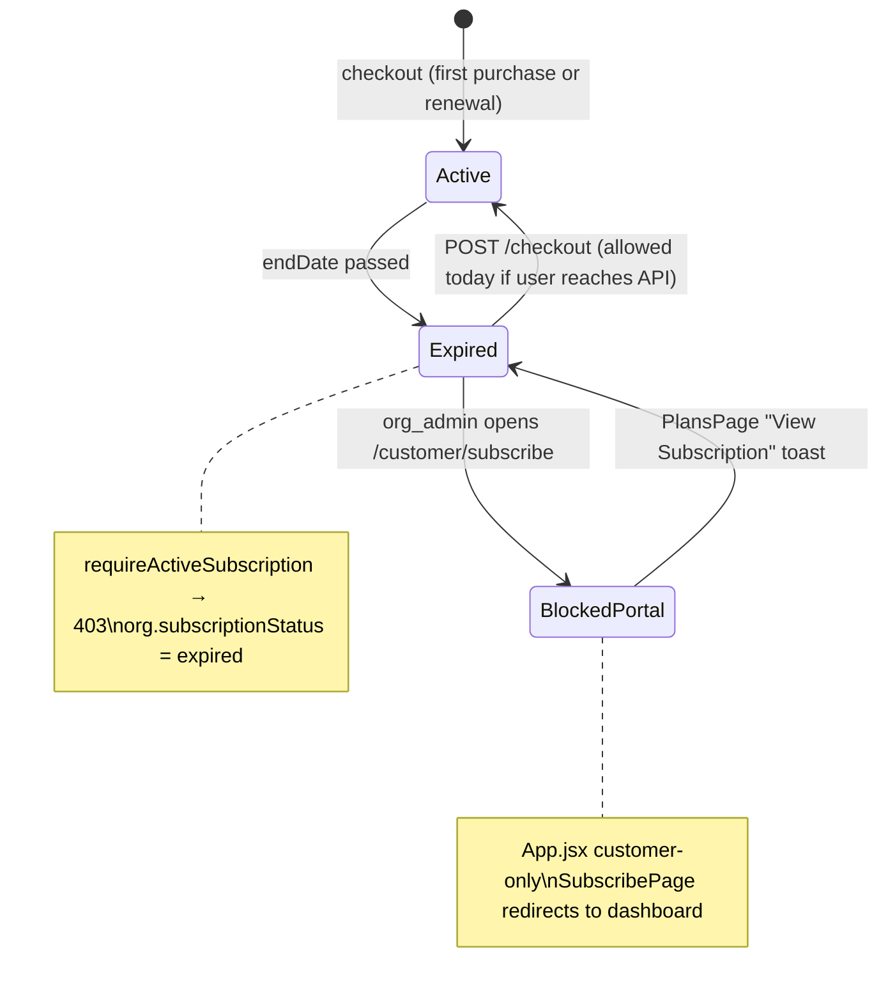

# Subscription Renewal & Re-subscribe — Implementation Plan

> **For agentic workers:** REQUIRED SUB-SKILL: Use superpowers:subagent-driven-development (recommended) or superpowers:executing-plans to implement this plan task-by-task. Steps use checkbox (`- [ ]`) syntax for tracking.

**Project phase:** **Phase 13** (Iteration 13) — *follows Phase 12 AI Inference per `docs/CURRENT_ITERATION.md` and `docs/REGRESSION_CHECKLIST.md`*

**Goal:** Restore a working self-service path for an **expired** organization admin to renew the same plan or subscribe to any other **active** plan, without creating a second organization, while preserving camera configuration on same-or-larger plans and **prompting** before checkout when a plan cannot fit current usage.

**Architecture:** Reuse simulated `POST /api/subscriptions/checkout` and `GET /api/users/me/account-summary`. The backend update path already reactivates the same `Organization` and `Subscription` documents. The product break is almost entirely **portal routing and UX**: subscribe routes and plan buttons treat every `org_admin` as a post-purchase user who cannot checkout again.

**Tech Stack:** Existing Express checkout, Mongoose `Organization` / `Subscription` / `Order` / `Camera` / `User`, React customer portal (`/customer/*`), Redux auth.

---

## Global Constraints

- Reuse `POST /api/subscriptions/checkout` and `GET /api/users/me/account-summary`. No payment gateway, webhooks, or new billing microservice.
- Do not create a second organization, change user role on renewal, or rename existing routes, roles, schema fields, or environment variables.
- Payment stays simulated; card fields are not charged.
- **While a term is still active** (`endDate` in the future, org + subscription active): checkout is blocked for **any** plan change (not only the same plan id).
- **Suspended** organizations cannot self-serve checkout; existing support messaging stays.
- **Inactive** plans stay rejected (`Subscription plan not found or inactive`).
- Renewal starts a **new term at checkout time**; it does not extend from the old `endDate`.
- **Same plan or larger plan:** existing cameras (records, URLs, settings, operator assignments) remain; do not reset `camerasUsed` / bulk-delete devices.
- **Smaller plan:** block checkout server-side; **prompt** on the client before navigation; never auto-delete cameras.
- Operators cannot renew; access returns when the org admin’s subscription is active again.
- Preserve authentication, JWT refresh, email verification, Google OAuth, RBAC, multi-tenant isolation, cameras, AI detection, alerts, Socket.io, subscription plan management, landing page, contact form.
- No database migration. No new npm dependencies unless explicitly authorized.
- Implement one sub-phase at a time, run that phase’s checks, update `docs/CURRENT_ITERATION.md`, update `docs/REGRESSION_CHECKLIST.md`, produce a change report, and stop for the next instruction.

---

## 1. Requirements vs Current State

| Requirement | Status | Evidence / gap |
|-------------|--------|----------------|
| Org admin can renew after expiry | ⚠️ Backend partial, frontend broken | `checkoutSubscription` updates existing org when `user.organizationId` is set; portal blocks `org_admin` from `/customer/subscribe` |
| Renew same plan — cameras intact | ✅ Intended on backend | Update branch keeps `camerasUsed`; `Camera` documents untouched |
| Renew different plan — limits updated | ✅ Backend | Org `maxCameras` / `maxOperators` overwritten from selected plan |
| Downgrade below current camera count | ❌ | No `Camera.countDocuments` guard in checkout; no UI prompt |
| Downgrade below operator count | ❌ | Same gap for `maxOperators` vs active operators |
| “Renew” CTAs reach checkout | ❌ | `AccountStatusBanner` text only; `SubscriptionPage` → “View Plans” with no renewal copy |
| Expired org admin can open Plans | ✅ | `/customer/plans` allows `PORTAL_ROLES` |
| Plan buttons for expired org admin | ❌ | `PlansPage` sends non-`customer` to subscription with “already active” toast |
| Block checkout while term active | ⚠️ Partial | Only **same** `planId` blocked when active; **different** plan id can slip through |
| Subscription doc status sync on expiry | ⚠️ Partial | `getAccountSummary` expires `Subscription`; `requireActiveSubscription` expires org only |
| Delete cameras to fit smaller plan while expired | ❌ Catch-22 | All camera routes use `requireActiveSubscription` — 403 when expired |

---

## 2. Industry Reference (SaaS Billing & Entitlements)

Patterns used by **Stripe Customer Portal**, **Chargebee**, **Zuora**, and surveillance SaaS (**Verkada**, **Eagle Eye**) for **lapsed** subscriptions:

| Pattern | This project (MVP) |
|---------|-------------------|
| **Single tenant per account** — renewal updates the same subscription record | One `Organization` per email; checkout updates in place |
| **Entitlement gate** — product APIs require active entitlement | `requireActiveSubscription` on cameras/alerts/incidents |
| **Reactivation checkout** — separate UX from first purchase (no “create org” again) | Renewal mode on `SubscribePage`: org name read-only/hidden |
| **Downgrade guard** — cannot move to a tier below **current usage** | Count live cameras (and operators); 400 + UI prompt |
| **Usage reduction lane** — when service is suspended/expired, allow **de-provisioning only** so customer can downgrade | Narrow middleware exception: list + delete cameras (and deactivate operators) when subscription expired, not suspended |
| **No mid-term plan swap** without billing engine | Block all checkout until `endDate` passed |
| **Order / invoice history** append-only | New `Order` per successful checkout (already) |
| **Admin override** | Super Admin `assignPlanToOrganization` stays out of scope |

**Recommendation:** Implement **client prompt + server enforcement + expired-state de-provisioning lane**. Do not auto-delete devices.

---

## 3. Root Cause (Why the Flow Feels “Broken”)

| Layer | Current behavior |
|-------|------------------|
| `checkoutSubscription` | Allows `org_admin` with existing org; blocks only **same plan** while still active |
| `requireActiveSubscription` | Sets org `expired`; does not set `Subscription.status` |
| `getAccountSummary` | Expires org + subscription; exposes `flags.isSubscriptionExpired`, `usage.camerasUsed` |
| `App.jsx` subscribe routes | `allowedRoles={["customer"]}` only |
| `SubscribePage.jsx` | Redirects `user.role !== "customer"` to dashboard |
| `PlansPage.jsx` | Non-customer → “already have active subscription” → My Subscription |
| `AccountStatusBanner.jsx` | “Renew your plan” with **no link** |

`GET /api/subscriptions/me` uses `requireActiveOrganization` only — org-admin subscription page still loads after expiry (good anchor for renew CTA).

---

## 4. Recommended Approach

### Option A — New `/renew` API and pages
Dedicated renewal endpoint and wizard. Clear naming, but duplicates checkout logic and violates “minimum diff.”

### Option B — Dual-mode checkout + account-summary-driven portal *(Recommended)*
Classify **first purchase** vs **renewal** in the existing subscribe flow; fix backend guards once; wire all renew CTAs to `/customer/plans` → `/customer/subscribe/:planId`. Matches Phase 9 purchase architecture.

### Option C — Super Admin manual assign only
No self-service. Unacceptable for SaaS MVP.

**Recommendation: Option B**, plus **Phase 13.2** de-provisioning exception so downgrade prompts are actionable.

---

## 5. Data & Business Rules

### 5.1 Successful renewal (same or different active plan)

- Same `organizationId`, same `Camera` rows, same operator assignments.
- `subscription.planId`, price, billing cycle, `startDate` / `endDate`, `status: active`.
- `camerasUsed` / `operatorsUsed` on `Subscription` **unchanged** (counters may drift from live counts — existing behavior).
- Organization `maxCameras`, `maxOperators`, `subscriptionStatus: active`, `status: ACTIVE`.
- New `Order` row (`approved`).

### 5.2 Downgrade / capacity rules (checkout)

When organization already exists, before writing subscription/org:

- `cameraCount = Camera.countDocuments({ organizationId, isDeleted: false })`
- If `cameraCount > plan.maxCameras` → **400** with message naming both numbers and next step (“remove cameras or choose a larger plan”).
- `operatorCount` = count active non-deleted operators in org (same pattern as Super Admin limit checks).
- If `operatorCount > plan.maxOperators` → **400** with analogous message.

### 5.3 Still-active term

Treat as **still active** only when **all** hold:

- `organization.status === 'ACTIVE'`
- `organization.subscriptionStatus === 'active'`
- `existingSubscription.status === 'active'`
- `existingSubscription.endDate > now`

→ **400** `You already have an active subscription. You can change plans after it expires.`

### 5.4 Suspended org

→ **403** `Your organization is suspended. Please contact support.`

### 5.5 Expired-state de-provisioning (new)

When `organization.subscriptionStatus === 'expired'` (or `flags.isSubscriptionExpired`) and org not suspended:

- Allow org_admin **read** camera list + **soft-delete** cameras (and deactivate operators if needed) **without** active subscription.
- Deny create/update/stream/inference for expired orgs (keep security surface minimal).

Implement via targeted middleware or route-level bypass — **do not** remove `requireActiveSubscription` globally.

---

## 6. Frontend UX — Downgrade Prompt

When `getAccountSummary()` shows renewal mode and user clicks a plan on `PlansPage`:

1. If `usage.camerasUsed <= plan.maxCameras` **and** operators fit → navigate to `/customer/subscribe/:planId`.
2. If over camera and/or operator limit:
   - **Do not navigate.**
   - Show modal (or inline panel): title **“This plan doesn’t fit your current usage”**, body with `N cameras in use, plan allows M`, same for operators if applicable.
   - Primary actions: **“Choose another plan”** (dismiss), **“Manage cameras”** → `/customer/downgrade-prep` or org-admin cameras route if exception allows access when expired.
   - Secondary: link to Help / contact support.

Optional: on `PlanCardGrid`, show badge **“Not enough camera slots”** when `usage.camerasUsed > plan.maxCameras` (renewal mode only).

Server-side 400 remains the source of truth if the client is stale.

---

## 7. Loophole & Edge-Case Register (must close in Phase 13)

| ID | Loophole | Risk | Closed by sub-task |
|----|----------|------|-------------------|
| L1 | Active term allows checkout for **different** `planId` | Mid-term plan swap without billing | 13.1.2 |
| L2 | Org `expired` but `Subscription.status` still `active` | Wrong UI / guard drift | 13.1.4, 13.1.5 |
| L3 | `organization.subscriptionEndDate` vs `subscription.endDate` mismatch | Wrong “active” decision | 13.1.1, 13.1.5 |
| L4 | `cancelled` / `pending` subscription status | Renewal blocked or ambiguous | 13.1.3 |
| L5 | Checkout with no capacity check | Downgrade over-provisions cameras | 13.1.6 |
| L6 | Live camera count vs `subscription.camerasUsed` counter | UI shows wrong fit | 13.4.4 (use `usage.camerasUsed` from summary) |
| L7 | Expired org cannot DELETE cameras | Downgrade impossible (catch-22) | 13.2.x |
| L8 | `POST /checkout` has no subscription middleware | Correct (must stay open) — document | 13.5.3 ADR |
| L9 | Double-submit / rapid double checkout | Duplicate orders | 13.3.5 |
| L10 | Customer with `organizationId` but role still `customer` | Wrong branch | 13.1.7 (existing 400 — verify) |
| L11 | Inactive / deactivated plan on deep link | Checkout 404 after form | 13.3.4, 13.4.5 |
| L12 | `pendingPlanId` → subscribe while active org_admin | Wrong redirect | 13.4.6 |
| L13 | Expiring-soon banner with no action | UX gap (renewal only after expiry by design) | 13.4.2 (copy only; no checkout) |
| L14 | Operators 403 on product routes but user CRUD may work | Inconsistent downgrade | 13.2.4 verify / 13.1.6 |
| L15 | Inference / MJPEG / alerts while expired | Security & cost | 13.2.2 (keep blocked) |
| L16 | Super Admin `assignPlan` during expired self-serve | Two writers | Out of scope — document |
| L17 | Partial write if subscription saves but order fails | Data inconsistency | 13.1.8 (best-effort ordering) |
| L18 | JWT / Redux role stale after renewal | UI wrong until refresh | 13.3.6 (tokens in response — already) |
| L19 | Landing CTA “Subscribe” for logged-in expired org_admin | Broken deep link | 13.4.6 |
| L20 | `CustomerPageShell` `onPurchasePlan` → `/subscribe` | Must work for renewal | 13.4.7 |

---

## 8. Shared Backend Helper (single source of truth)

**File (create):** `backend/utils/subscriptionTerm.js` *(or inline in controller if team prefers zero new files — prefer extract to avoid L2/L3)*

- [ ] **13.0.1** `isSubscriptionTermActive({ organization, subscription, now })` — implements §5.3 using **both** org dates/status and subscription document when present; if `endDate` past, treat as not active even if status string lagging.
- [ ] **13.0.2** `isOrganizationRenewable({ organization, subscription })` — true when org exists, not suspended, and term not active (expired, cancelled, past end, or missing subscription doc).
- [ ] **13.0.3** `getOrganizationUsageCounts(organizationId)` — `{ cameraCount, operatorCount }` using same queries as checkout guard (`Camera` non-deleted; `User` operators active non-deleted).
- [ ] **13.0.4** Use helper in `checkoutSubscription`, and optionally in `getAccountSummary` flags (minimal change — only if flags drift observed in QA).

**Stop after 13.0** only if explicitly scheduled; otherwise implement 13.0 together with **13.1**.

---

## 9. Implementation Phases Overview (Iteration 13)

| Phase | Scope | Deliverable |
|-------|--------|-------------|
| **13.0** | Shared term + usage helpers | One definition of “active term” and usage counts |
| **13.1** | Backend renewal rules + capacity + expiry sync | Hardened checkout |
| **13.2** | Expired de-provisioning lane | Downgrade path actionable |
| **13.3** | Portal dual-mode checkout | org_admin can pay simulated renewal |
| **13.4** | Entry points + capacity UX + deep links | Full funnel |
| **13.5** | Docs, ADR, regression | Iteration closure |
| **13.6** | End-to-end QA matrix | Sign-off |

---

## Phase 13.1 — Backend renewal rules (sub-tasks)

**Files:** `backend/controllers/subscriptionController.js`, `backend/middleware/auth.js`, `backend/utils/subscriptionTerm.js`

### 13.1.1 — Load org + subscription before any write

- [ ] After resolving `plan`, if `user.organizationId`: load `organization` (not deleted) and `existingSubscription` by `organizationId`.
- [ ] If org missing → **400** `Organization record not found for this account` (unchanged).
- [ ] Do **not** create org when `user.organizationId` is set (unchanged).

### 13.1.2 — Block checkout while term still active (L1)

- [ ] Call `isSubscriptionTermActive(...)`.
- [ ] If true → **400** `You already have an active subscription. You can change plans after it expires.` for **any** `planId` (not same-plan-only).
- [ ] Place guard **before** capacity checks and **before** any DB writes.

### 13.1.3 — Block suspended org (L4 context)

- [ ] If `organization.status === 'SUSPENDED'` → **403** `Your organization is suspended. Please contact support.`
- [ ] Run for org_admin renewal path only when org exists.

### 13.1.4 — Allow renewal when term not active

- [ ] Explicitly allow when any of: `subscriptionStatus === 'expired'`, `subscription.status === 'expired'`, `subscription.status === 'cancelled'`, `endDate <= now`, org/subscription status desync (helper resolves to not active).
- [ ] Do **not** require `organizationName` on this path.

### 13.1.5 — Sync expiry in `requireActiveSubscription` (L2)

- [ ] When `org.subscriptionEndDate < now` and status not yet `expired`: set `org.subscriptionStatus = 'expired'`.
- [ ] Load `Subscription.findOne({ organizationId })`; if `status === 'active'` and `endDate < now`, set `status = 'expired'`.
- [ ] Keep 403 message: `Your subscription is not active. Please renew your plan.`

### 13.1.6 — Capacity guard before writes (L5, L14)

- [ ] `const { cameraCount, operatorCount } = await getOrganizationUsageCounts(organization._id)`.
- [ ] If `cameraCount > plan.maxCameras` → **400** `This plan allows ${plan.maxCameras} cameras and your organization has ${cameraCount}. Remove cameras or choose a larger plan.`
- [ ] If `operatorCount > plan.maxOperators` → **400** with parallel operator message.
- [ ] Use **live counts**, not `subscription.camerasUsed` alone.

### 13.1.7 — First-purchase guards unchanged (L10)

- [ ] `customer` + `organizationId` → **400** existing message (cannot second org).
- [ ] `customer` without org → require `organizationName`; create org; set `org_admin`.
- [ ] Reject roles other than `customer` / `org_admin` at checkout (unchanged).

### 13.1.8 — Renewal write ordering (L17)

- [ ] Order of operations: validate plan → validate term → validate capacity → update/create `Subscription` → update `Organization` → create `Order` → issue tokens.
- [ ] On any failure before `Order.create`, no order row (existing pattern — verify no orphan order on thrown error after order create; if risk remains, wrap in try/catch and delete order on downstream failure — only if QA proves issue).

### 13.1.9 — Renewal field contract (§5.1)

- [ ] Set `subscription.planId`, `plan`, `price`, `billingCycle`, `status: 'active'`, `startDate: now`, `endDate: addMonths(now, plan.durationMonths || 1)`.
- [ ] Preserve `camerasUsed`, `operatorsUsed` on update branch.
- [ ] Set org `subscriptionPlanId`, `subscriptionPlan` (legacy key), `subscriptionStatus: 'active'`, dates, `maxCameras`, `maxOperators`, `status: 'ACTIVE'`.
- [ ] Response shape unchanged.

### 13.1.10 — Checkout route middleware audit (L8)

- [ ] Confirm `POST /api/subscriptions/checkout` stays **without** `requireActiveSubscription` / `requireActiveOrganization`.
- [ ] Document in ADR: checkout is intentional entitlement bypass for renewal.

### Phase 13.1 verification (required before 13.2)

- [ ] V1 Expired org_admin, same plan → 200, same `organizationId`, camera count unchanged, new order.
- [ ] V2 Expired, different plan → 200, `maxCameras`/`maxOperators` match plan.
- [ ] V3 Active term, different plan → 400 still-active message.
- [ ] V4 Active term, same plan → 400 still-active message.
- [ ] V5 Suspended → 403.
- [ ] V6 Inactive plan → 404.
- [ ] V7 Camera over limit → 400, subscription stays expired, order count unchanged.
- [ ] V8 Operator over limit → 400.
- [ ] V9 New customer → one org, role `org_admin`.
- [ ] V10 After past `endDate`, camera route → 403 until renewed.

---

## Phase 13.2 — Expired de-provisioning lane (sub-tasks)

**Goal (industrial):** **Read-only + shrink** entitlement while lapsed — no new features, no streaming, no inference.

**Files:** `backend/middleware/auth.js`, `backend/routes/cameras.js`, optional `backend/routes/users.js` or operator routes

### 13.2.1 — Define `allowExpiredDeprovision` predicate

- [ ] True when: `req.user.role === 'org_admin'`, org exists, `org.status === 'ACTIVE'`, `org.status !== 'SUSPENDED'`, subscription not active per `isSubscriptionTermActive` (or org `subscriptionStatus === 'expired'`).

### 13.2.2 — Middleware: `requireActiveSubscriptionUnlessDeprovision`

- [ ] If normal active subscription → `next()`.
- [ ] Else if deprovision predicate and route/method in allowlist → `next()` with `req.deprovisionMode = true`.
- [ ] Else → existing 403.

### 13.2.3 — Camera route allowlist (L7, L15)

- [ ] Allow: `GET /api/cameras`, `GET /api/cameras/usage`, `DELETE /api/cameras/:id` (org_admin only for delete).
- [ ] Deny: `POST`, `PUT`, `PATCH`, MJPEG stream, restore/permanent delete, operator assignment routes.
- [ ] Apply by restructuring `cameras.js`: run allowlist routes **before** global `requireActiveSubscription`, or use conditional middleware.

### 13.2.4 — Operator reduction path (L14)

- [ ] Verify `DELETE /api/users/:id` (org_admin) works when subscription expired (`users.js` has no subscription middleware).
- [ ] If blocked elsewhere, add same deprovision allowlist for operator deactivate/delete only.
- [ ] Document in UI: remove operators before downgrade if over limit.

### 13.2.5 — Controller guards in deprovision mode

- [ ] In `deleteCamera`, reject create/update paths when `req.deprovisionMode` if any shared handlers.
- [ ] Ensure multi-tenant: org_admin cannot touch other org cameras (existing).

### 13.2.6 — Frontend de-provision surface

- [ ] **Option A (recommended):** `frontend/src/pages/customer/DowngradePrepPage.jsx` — list cameras from API, delete with confirm, show `usage / selectedPlanLimit`, CTA back to Plans.
- [ ] **Option B:** Org-admin `Cameras.jsx` with banner when expired — only if route reachable without active subscription (layout guards audit).
- [ ] Register route under `/customer/downgrade-prep` with `PORTAL_ROLES`, optional query `?planId=` for limit display.

### Phase 13.2 verification

- [ ] V11 Expired + 8 cameras → GET list works, DELETE works, POST camera 403.
- [ ] V12 After deletes → checkout smaller plan succeeds.
- [ ] V13 Active subscription → DELETE still allowed (normal) but deprovision mode not required.
- [ ] V14 MJPEG / inference / alerts → 403 when expired.

---

## Phase 13.3 — Portal dual-mode checkout (sub-tasks)

**Files:** `frontend/src/App.jsx`, `frontend/src/pages/customer/SubscribePage.jsx`, optional `frontend/src/utils/checkoutMode.js`

### 13.3.1 — Route RBAC

- [ ] Both `/customer/subscribe` and `/customer/subscribe/:planId` use `ProtectedRoute allowedRoles={PORTAL_ROLES}`.

### 13.3.2 — Checkout mode enum

- [ ] **`first_purchase`** — customer, no org.
- [ ] **`renewal`** — org_admin (or has org) + renewable flags from summary.
- [ ] **`blocked_active`** — has active term → redirect.
- [ ] **`blocked_suspended`** — suspended → redirect + toast optional.

### 13.3.3 — Load account summary on subscribe mount

- [ ] Fetch `getAccountSummary()`; derive mode; show skeleton until resolved.
- [ ] Remove unconditional `user.role !== 'customer'` → dashboard redirect.

### 13.3.4 — Plan list + selection

- [ ] Load public plans; preselect `routePlanId` or pending plan.
- [ ] If selected plan inactive/missing → error state + link to Plans (L11).
- [ ] In renewal mode, show read-only org card (name, email) from summary.

### 13.3.5 — Form fields by mode

- [ ] **first_purchase:** organization name, phone, address, simulated card (unchanged).
- [ ] **renewal:** hide org name/address; optional phone update out of scope; submit `{ planId }` only.
- [ ] Submit button: `Complete purchase` vs `Renew subscription`.
- [ ] Disable submit while summary loading or `submitting` (L9).

### 13.3.6 — Submit + auth refresh (L18)

- [ ] On success: persist tokens, `dispatch(setUser)`, `socketService` reconnect if used elsewhere.
- [ ] Navigate `/customer/subscription?success=1&renewed=1` for renewal (query drives copy).

### 13.3.7 — Error handling

- [ ] Map 400 still-active → toast + redirect subscription.
- [ ] Map capacity 400 → toast + button/link to `/customer/downgrade-prep?planId=`.
- [ ] Map 403 suspended → toast + subscription page.

### 13.3.8 — Success messaging

- [ ] `SubscriptionPage`: if `renewed=1`, show “Subscription renewed” (not first-purchase welcome copy).

### Phase 13.3 verification

- [ ] V15 Expired org_admin completes renewal without org name.
- [ ] V16 Active org_admin hitting subscribe URL → redirect subscription.
- [ ] V17 Customer first purchase unchanged.

---

## Phase 13.4 — Entry points, capacity UX, deep links (sub-tasks)

**Files:** Plans, banners, subscription pages, menu, FAQ, PlanCardGrid/PlanCard, Dashboard, LandingPage, CustomerPageShell

### 13.4.1 — Central renewal eligibility hook

- [ ] Create `frontend/src/hooks/useRenewalEligibility.js` (or util): wraps `getAccountSummary()`, exposes `{ mode, flags, usage, loading, error, refetch }`.
- [ ] Single definition for: `canRenew`, `canCheckoutPlan(plan)`, `isRenewalMode`.

### 13.4.2 — `PlansPage.jsx`

- [ ] Use hook; `disableSubscribe` while loading.
- [ ] Per-plan `subscribeLabel`: Subscribe | Renew | View Subscription.
- [ ] `handleSubscribeClick(plan)`: if renewal + over capacity → open modal; else if renewal → navigate subscribe; else existing customer flow; else active → toast + subscription.

### 13.4.3 — `PlanCapacityModal.jsx` (§6)

- [ ] Props: `plan`, `usage`, `onClose`, `onManageCameras`, `onChooseOther`.
- [ ] Show camera and operator lines when over limit.
- [ ] `onManageCameras` → `/customer/downgrade-prep?planId=`.

### 13.4.4 — `PlanCard` / `PlanCardGrid` enhancements (L6)

- [ ] Optional prop `planCapacityHint(plan)` → badge “Not enough slots” in renewal mode when over camera limit.
- [ ] Do not disable card entirely — click opens modal (education).

### 13.4.5 — Inactive plan on grid

- [ ] Public API returns active only — if stale plan id in URL, subscribe page handles (13.3.4).

### 13.4.6 — Deep links (L12, L19)

- [ ] `Dashboard` pendingPlanId effect: if summary loaded and **blocked_active**, clear pending + redirect subscription with toast (do not open checkout).
- [ ] If **renewal** mode + pendingPlanId → subscribe route (after 13.3).
- [ ] `LandingPage` authenticated portal user + plan click: same rules via `getDashboardPathForRole` / pending plan flow.

### 13.4.7 — `CustomerPageShell` / sidebar CTAs (L20)

- [ ] `onPurchasePlan`: org_admin in renewal mode → `/customer/plans` not broken legacy path; customer → `/customer/plans` or subscribe as today.

### 13.4.8 — `AccountStatusBanner.jsx`

- [ ] Expired: add `<Link to="/customer/plans">Renew plan</Link>`.
- [ ] Expiring soon: optional “You can renew after {date}” (L13 — no early checkout).

### 13.4.9 — `SubscriptionPage.jsx`

- [ ] CTA: `Renew or change plan` → `/customer/plans` when renewable.
- [ ] Different success banner for `renewed=1` vs first purchase.

### 13.4.10 — `orgadmin/Subscription.jsx`

- [ ] When `subscription.status` or org status is `expired` / `cancelled`: prominent link to `/customer/plans`.
- [ ] Note: page loads via `GET /subscriptions/me` without active subscription — unchanged.

### 13.4.11 — `CustomerProfileMenu.jsx`

- [ ] `org_admin` + renewable: menu item **Renew plan** → `/customer/plans`.
- [ ] Hide **Purchase Plan** for org_admin.

### 13.4.12 — `faq.js`

- [ ] Expiry: renew via Plans → checkout; cameras kept; downgrade requires removing devices first.
- [ ] One-org: after expiry, same org renewed in place; checkout blocked during active term.

### 13.4.13 — Operator experience

- [ ] No renewal UI for operators (unchanged).
- [ ] Optional: operator login when expired sees contact admin message (existing 403 — no change required).

### Phase 13.4 verification

- [ ] V18 Banner → Plans → Renew → success.
- [ ] V19 Over-capacity plan → modal → downgrade prep → renew.
- [ ] V20 Profile menu renew path.
- [ ] V21 Org-admin subscription page link.

---

## Phase 13.5 — Documentation & ADR (sub-tasks)

- [ ] **13.5.1** `docs/CURRENT_ITERATION.md` — Iteration 13, checklist per sub-phase.
- [ ] **13.5.2** `docs/REGRESSION_CHECKLIST.md` — new “Subscription renewal (Phase 13)” section with V1–V21 pointers.
- [ ] **13.5.3** `docs/ARCHITECTURE_DECISIONS.md` — ADR: renewal reuses checkout; term definition; deprovision exception; no mid-term swap.
- [ ] **13.5.4** Update FAQ path in Help if linked statically anywhere.

---

## Phase 13.6 — End-to-end QA matrix (industrial sign-off)

### Entitlement states

| State | Checkout | Cameras read | Cameras write | Alerts/incidents |
|-------|----------|--------------|---------------|------------------|
| Active | Block | Yes | Yes | Yes |
| Expired | Allow (org_admin) | Deprovision only | Delete only | No |
| Suspended | Block | No | No | No |
| Customer no org | Allow (first purchase) | N/A | N/A | N/A |

### Personas

- [ ] **P1** Org admin, expired, same plan, same camera count.
- [ ] **P2** Org admin, expired, upgrade plan.
- [ ] **P3** Org admin, expired, downgrade within capacity.
- [ ] **P4** Org admin, expired, downgrade over capacity → modal → deprovision → checkout.
- [ ] **P5** Org admin, active term, attempts API checkout → 400.
- [ ] **P6** Customer first purchase.
- [ ] **P7** Operator during expired org → 403 product routes; admin renews → operator access restored.
- [ ] **P8** Super Admin plan deactivate — expired user cannot renew onto inactive plan.

### Non-functional

- [ ] `npm run build` frontend exit 0.
- [ ] Backend requires no new env vars.
- [ ] No new npm deps unless approved.

---

## 14. Testing Checklist (QA — mirrors Phase 13.6)

### Org admin — expired

- [ ] Renew **same** plan — cameras/settings/assignments present after renewal.
- [ ] Renew **larger** plan — higher limits, no data loss.
- [ ] Select **smaller** plan with too many cameras — modal prompt, no checkout; after de-provision, checkout succeeds.
- [ ] Operators regain access after admin renews.

### Org admin — active

- [ ] Cannot checkout any plan until expiry.
- [ ] Plans page does not open checkout.

### Customer — first purchase

- [ ] Unchanged: org creation, role promotion, redirect.

### Regression

- [ ] Auth, JWT refresh, OAuth, RBAC, multi-tenant isolation.
- [ ] Super Admin plan CRUD, orders, assign plan.
- [ ] AI inference, alerts, Socket.io after renewal.
- [ ] `npm run build` (frontend); backend smoke load.

---

## 15. Out of Scope

- Real payments, proration, tax, invoices, dunning emails, `autoRenew` charging.
- Mid-term upgrade/downgrade while `endDate` in the future.
- Automatic camera/operator deletion to fit a plan.
- Operator-initiated renewal.
- Changes to Super Admin `assignPlanToOrganization` beyond documenting behavior.
- Schema changes to `Order.subscriptionPlan` or new collections.

---

## 16. Files Summary

| Action | Path |
|--------|------|
| Create | `backend/utils/subscriptionTerm.js` |
| Modify | `backend/controllers/subscriptionController.js` |
| Modify | `backend/middleware/auth.js` |
| Modify | `backend/routes/cameras.js` |
| Modify | `frontend/src/App.jsx` |
| Modify | `frontend/src/pages/customer/SubscribePage.jsx` |
| Modify | `frontend/src/pages/customer/PlansPage.jsx` |
| Modify | `frontend/src/pages/customer/SubscriptionPage.jsx` |
| Modify | `frontend/src/pages/customer/Dashboard.jsx` |
| Modify | `frontend/src/pages/public/LandingPage.jsx` |
| Modify | `frontend/src/components/account/AccountStatusBanner.jsx` |
| Modify | `frontend/src/components/plans/PlanCard.jsx`, `PlanCardGrid.jsx` |
| Modify | `frontend/src/pages/orgadmin/Subscription.jsx` |
| Modify | `frontend/src/components/CustomerProfileMenu.jsx` |
| Modify | `frontend/src/components/CustomerPageShell.jsx` |
| Modify | `frontend/src/data/faq.js` |
| Create | `frontend/src/components/plans/PlanCapacityModal.jsx` |
| Create | `frontend/src/pages/customer/DowngradePrepPage.jsx` |
| Create | `frontend/src/hooks/useRenewalEligibility.js` |
| Optional | `frontend/src/utils/checkoutMode.js` |
| Modify | `docs/CURRENT_ITERATION.md`, `docs/REGRESSION_CHECKLIST.md`, `docs/ARCHITECTURE_DECISIONS.md` |

---

## 17. Suggested Execution Order (one sub-phase per agent step)

1. **13.0** + **13.1** — Helpers + hardened checkout (run V1–V10 before any frontend).
2. **13.2** — De-provisioning lane (V11–V14).
3. **13.3** — Subscribe dual-mode (V15–V17).
4. **13.4** — Funnel + modal + deep links (V18–V21).
5. **13.5** — Docs / ADR.
6. **13.6** — Full persona matrix (P1–P8) + regression + build.

After **each** numbered sub-phase group above: update `docs/CURRENT_ITERATION.md`, change report, **stop** for next instruction.

---

## 18. Self-Review (Spec Coverage)

| User requirement | Covered by |
|------------------|------------|
| Resubscribe after expiry | 13.1, 13.3, 13.4 |
| Same plan keeps camera config | §5.1, 13.1 checks |
| Smaller plan → prompt | §6, 13.4, 13.2 |
| Industrial entitlement + billing patterns | §2 |
| No duplicate org | Global constraints, existing checkout branch |
| Phase numbering aligned with repo | **Phase 13** after Phase 12 Inference |

No code changes are included in this document; implementation follows the iteration workflow in `.cursor/rules/00-project-safety.mdc`.
